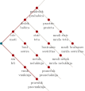
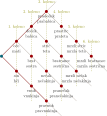
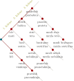
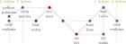

# Rodoslovje

## Sorodstveni izrazi

### Krvno sorodstvo

Na sliki spodaj:

- izhodiščna oseba je označena modro piko;
- sorodniki v t. i. *ravni črti* (označeni z rdečimi pikami) so predniki in potomci
  izhodiščne osebe;
- sorodniki v t. i. *stranski črti* (označena z belo/črno) so vsi ostali krvni
  sorodniki - imajo skupnega prednika z izhodiščno osebo, a niso predniki ali
  potomci

Iz skice je razvidnih še nekaj pravil:

- naziv *mali*/*mrzli* se dodaja ob pomikanju v desno od izhodiščne osebe
  (potemtakem bi lahko *bratrancu* rekli tudi *mali brat*);
- predpona *pra*- se dodaja ob pomikanju desno navzgor oz. dol od izhodiščne
  osebe (potemtakem bi lahko *dedku* rekli tudi *praoče*)

{.obrnljivaS}

#### Kolena

Pri "običajnih" kolenih se štejejo povezave, oz. kolikokrat se ta zalomi
(primer: z bratrancem si v sorodu v četrtem kolenu, ker si z njim povezan preko
starša, starih staršev, tete/strica do bratranca).

Iz spodnje skice je razvidno:

1. koleno: starši in otroci izhodiščne osebe;
2. koleno: stari starši, sorojenci in vnuki/vnukinje;
3. koleno: prastari starši, strici/tete, nečaki/nečakinje, pravnuki/pravnukinje;
4. ...

{.obrnljivaS}

Drugi način označevanja kolen je po skupnih prednikih:

1. koleno: starši in njihovi potomci (razen izhodiščne osebe in njenih
   potomcev);
2. koleno: stari starši in njihovi potomci (razen staršev izh. os. in njihovih
   potomcev);
3. ...

{.obrnljivaS}

### Svaštvo

{.obrnljivaT}
